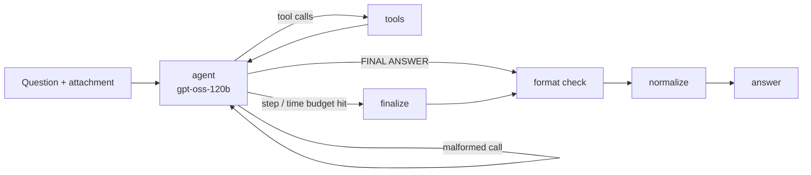

# Zero-Cost GAIA Agent

A tool-using research agent that scored **90% (18/20)** on the **GAIA benchmark (Level 1)** course set, built with **LangGraph** and running entirely
on **free-tier Cloudflare Workers AI models**. Model cost: $0.

Built for the final assignment of the [Hugging Face Agents Course](https://huggingface.co/learn/agents-course) (Unit 4).

| | |
|---|---|
| **Score** | **90% (18/20)** on the course's GAIA Level 1 set (pass mark: 30%) |
| **Brain** | `@cf/openai/gpt-oss-120b` (free tier) |
| **Vision** | `@cf/google/gemma-4-26b-a4b-it` |
| **Speech** | `@cf/openai/whisper-large-v3-turbo` |
| **Framework** | LangGraph |
| **Code mirror** | [HF Space](https://huggingface.co/spaces/Harsh5764/zero-cost-gaia-agent) (static; HF now needs a paid plan to run Gradio Spaces) |

## What GAIA asks

GAIA questions are short but take several steps to answer. Examples from this set:

- Read a chess board from an image and find the winning move for Black
- Count bird species visible at the same time in a YouTube video
- Transcribe a voice memo and pull out the page numbers a professor mentioned
- Find who nominated a specific Wikipedia Featured Article in November 2016
- Total the food sales (excluding drinks) in an attached Excel file

Scoring is **exact match**, so a right answer in the wrong format scores zero.

## Architecture



- **agent:** a ReAct-style loop with up to 25 steps and 8 minutes per question.
- **format check:** one extra model call that fixes formatting only, such as alphabetical order or units. A code guard
  rejects any change that adds or alters words, so the checker can't change the actual answer.
- **normalize:** strips leftover model tokens, quotes and markdown, trailing periods and thousands separators.
- **self-consistency:** each question is answered 3 times, and the majority answer wins. List answers are voted
  position by position.

### Tools

| Tool | What it does |
|---|---|
| `web_search` | Google results via Serper |
| `fetch_page` / `find_in_page` | Page or PDF as markdown, with paging and keyword search |
| `wikipedia_search` / `wikipedia_page` | Articles with tables, including **historical revisions** ("use the 2022 version") |
| `read_file` | xlsx (every sheet), csv, pdf, docx, json, code |
| `transcribe_audio` | Whisper on Cloudflare |
| `describe_image` | Vision questions about an image |
| `youtube_transcript` | Captions, or Whisper on the audio when there are none |
| `youtube_frames` | Samples frames across the whole video, asks a vision model about each, and reports the per-frame maximum |
| `run_python` | Sandboxed subprocess with a timeout, for any calculation |
| `chess_image_to_fen` | Splits the board into 64 squares, identifies each one, reads the printed coordinates to handle flipped boards, then runs **Stockfish** |

## Problems I had to solve

Free models are workable, but they have rough edges. Most of the engineering went here:

1. **Cloudflare rejects `content: null`.** LangChain sends null content on assistant messages that only carry tool
   calls, and Cloudflare's schema rejects that. Fixed with a placeholder string.
2. **gpt-oss tool-call quirks.**
   - It sometimes passes raw Python code as the tool arguments instead of JSON. These calls are repaired.
   - It sometimes writes a tool call into the reply text instead of making one. These replies are detected and
     resampled. Before this fix, the agent once made up an ingredient list without listening to the audio.
3. **Free-tier quotas.** Each account gets 10k "neurons" a day. The client switches to the next account on a 429.
   I also turned off the SDK's own retries, which were waiting out long `Retry-After` delays.
4. **Chess from an image.** Whole-board vision gets it wrong, especially when the board is drawn from Black's side.
   Identifying each square separately and handling orientation in code makes it reliable.
5. **Exact-match formatting.** The normalizer and a guarded format-check step handle details such as
   `$89,706.00 → 89706.00`, while keeping `132,133,134` as a list rather than one number.
6. **Run-to-run variance.** Majority voting over 3 runs settles answers that flip between runs.

## Integrity

- No answers are hardcoded, and the code never branches on a task ID or question text.
- The GAIA ground truth is never read. Attachments are fetched by filename because the course `/files` endpoint
  returns 404; the answer metadata is never downloaded.
- Search and fetch **block known answer-leak sources** (public datasets and Spaces that contain GAIA answers), so
  answers come from primary sources.

## Run it yourself

```bash
uv sync
cp .env.example .env        # Cloudflare account ID and token, Serper key, HF token
uv run python run_local.py  # all questions; traces go to runs/<timestamp>/traces/*.md
uv run python vote.py --since <first-run-folder>   # majority vote across runs
uv run python app.py        # Gradio UI (log in with HF, run, submit)
```

Every run writes a readable trace per question (reasoning, tool calls and tool output), so you can see exactly why
an answer came out the way it did.

## Project layout

```
agent/graph.py     LangGraph graph, prompts, tool-call repair, format check
agent/llm.py       Cloudflare clients, account rotation, vision and Whisper helpers
agent/tools/       web, files, video, code/chess tools
agent/answer.py    exact-match normalizer
agent/files.py     attachment fetching
run_local.py       local runner with traces
vote.py            self-consistency voting
app.py             Gradio app for the HF Space (login, run, submit)
```
